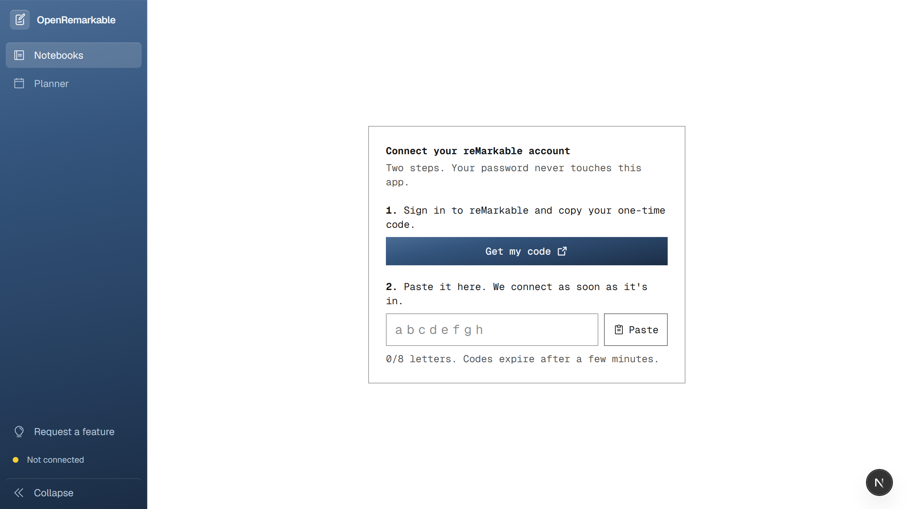
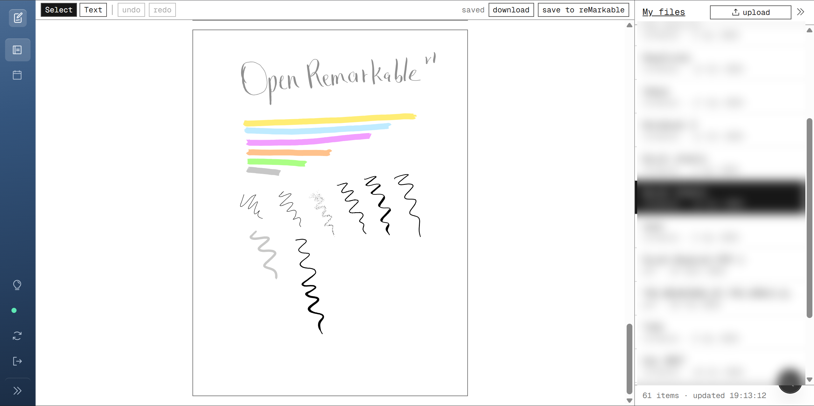
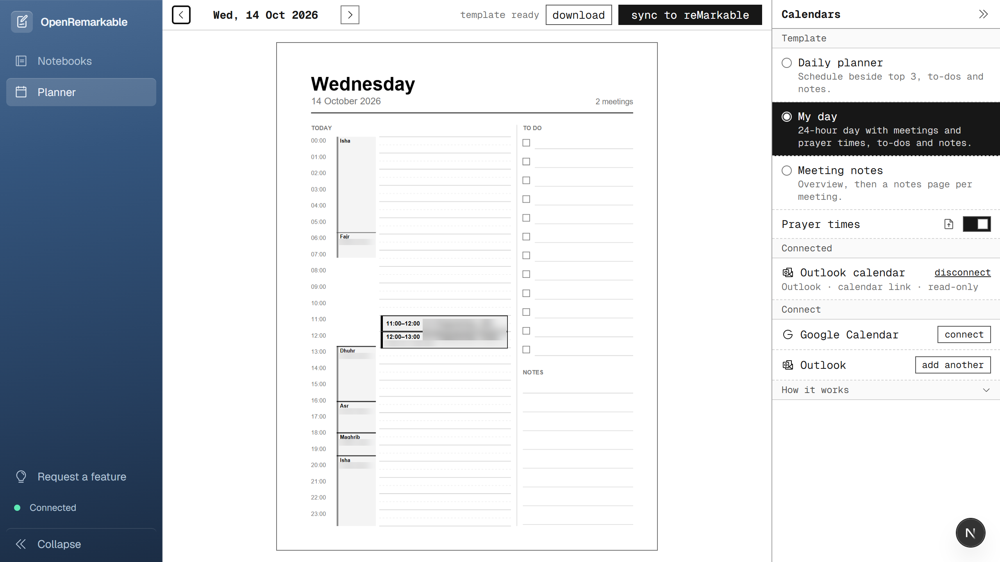
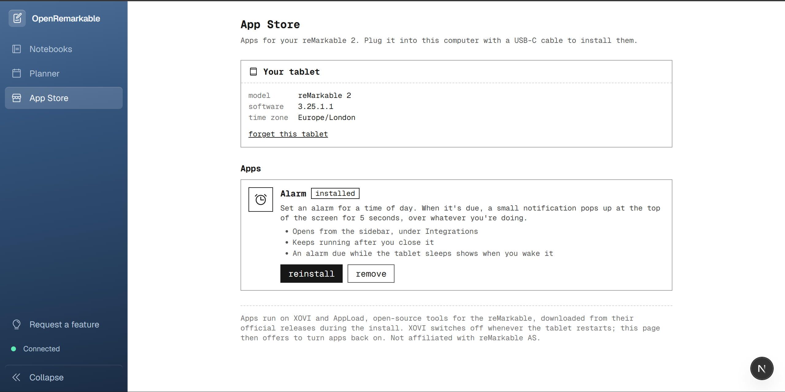
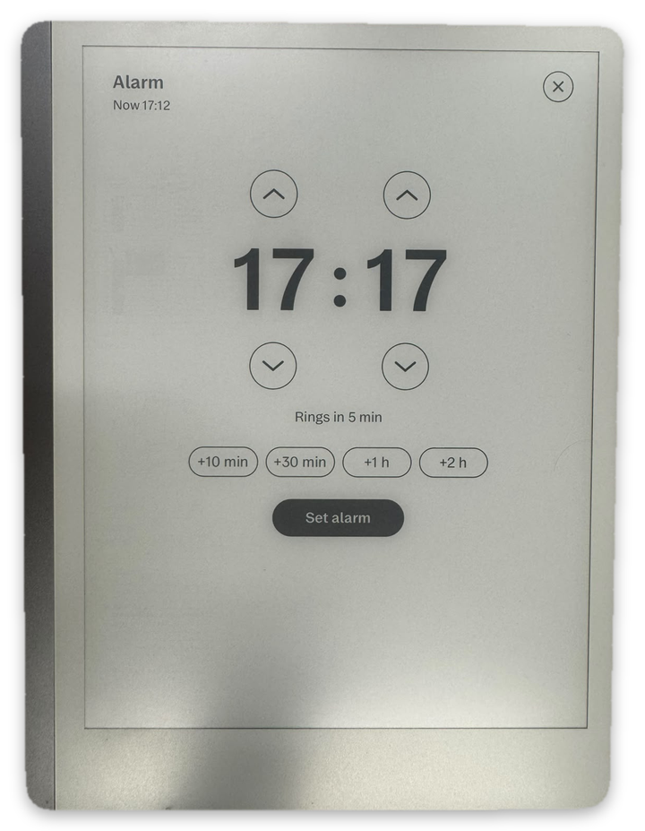
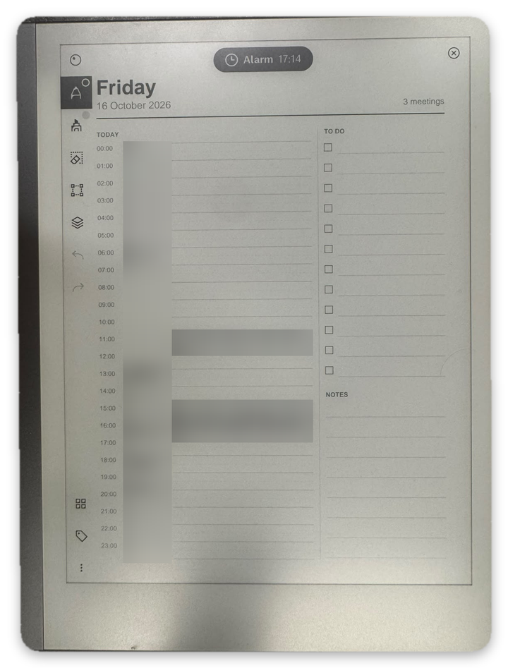
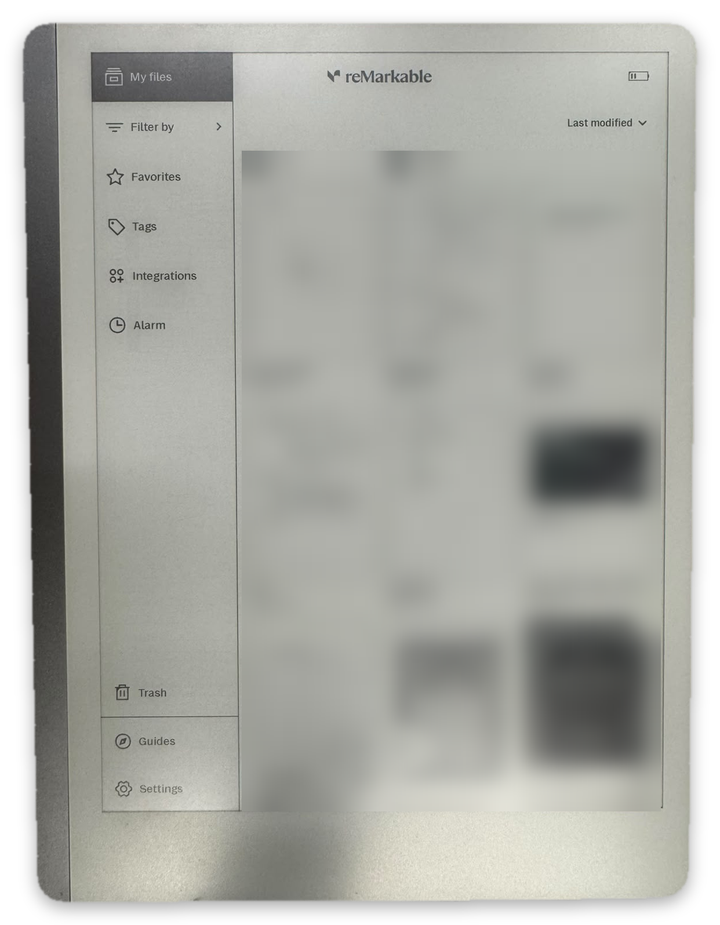

# OpenRemarkable

A Next.js and TypeScript web app for the reMarkable tablet. It fetches your notebooks and PDFs from the reMarkable cloud and converts the raw `.rm` page files (pen strokes, typed text and PDF annotations) into vector PDFs that you can read in the browser. The conversion is our own TypeScript renderer. Its rules for pen shapes, widths, colours and page layout were reverse engineered from the official reMarkable desktop app, so pages look as they do there.

It can also upload PDFs, add typed text to notebooks and sync day planners built from your Outlook or Google Calendar back to the tablet.

Its App Store installs new apps onto the tablet itself, straight from the browser over a USB-C cable: no terminal or manual setup. The apps hook into the tablet's own interface, whose QML screens we reverse engineered. The first app is an Alarm with a pop-up notification that shows over any screen.

## Getting started

You need [Node.js](https://nodejs.org) 20.9 or newer.

```bash
git clone https://github.com/YS403/Openremarkable.git
cd Openremarkable
npm install
npm run dev
```

Open [http://localhost:3000](http://localhost:3000). The App Store downloads XOVI and AppLoad itself when you install an app, so there's nothing else to set up.

## Connect your reMarkable



Press **Get my code** to sign in on reMarkable's own site and copy a one-time code, then paste it in. The app connects as soon as all 8 letters are in. Your reMarkable password is never entered here.

## Notebooks



Your reMarkable files are listed on the right; pick one to open it. The page shows your handwriting exactly as on the tablet, every pen and colour included. **Text** adds typed text to the page, **download** saves it as a PDF, and **save to reMarkable** sends your changes back to the tablet. Use **upload** to add a PDF from your computer.

## Planner



The Planner turns your calendar into day pages for your reMarkable, so you can plan and take notes by hand.

**How it works:** connect your Outlook or Google Calendar with its private link (read-only), pick a page template and press **sync to reMarkable**. Today and the next 6 days arrive on your tablet as one "Planner" notebook. Sync again whenever your meetings change: changed days are redrawn on the same page, and what you've written stays. You can also turn on prayer times and upload your mosque's timetable to show each prayer window beside your schedule.

Signing in directly with a Microsoft or Google account is planned but not built yet: work and school accounts usually need an IT admin to approve that kind of access. For now, calendars connect through their private calendar link, which needs no approval.

## App Store



Install apps on your reMarkable 2 from the browser. Plug the tablet in with USB-C, enter its root password once (Settings → Help → Copyrights and licenses), and press **install**. The first app is **Alarm**: pick a time, and a small notification pops up at the top of the screen when it's due.

<p align="center">
  
  
  
</p>

*Set a time · the notification over a planner page · Alarm in the tablet's sidebar*

**How it works:** the tablet's interface is built in Qt/QML. We reverse engineered its screens to find where an app can hook in. The apps run on [XOVI](https://github.com/asivery/xovi) and [AppLoad](https://github.com/asivery/rm-appload), open-source tools that patch the interface while it runs. Our patches add the Alarm to the sidebar and a notification layer over every screen.

**Installing from the browser:** the browser can't reach the tablet itself, so you run OpenRemarkable locally and its server, on your own computer, does the work. It connects over SSH to the tablet's USB address (10.11.99.1), using the password once to add a key; the password is never stored. It downloads XOVI and AppLoad from their official releases and checks them against pinned checksums. It then builds the app's Qt resource file in TypeScript, copies everything across and restarts the tablet's screen. Progress streams back to the page step by step.

**Limits:** it only works when OpenRemarkable runs on the computer the tablet is plugged into, opened at `localhost`. The install routes refuse other hosts, other websites and hosted deployments.

**Tested setup:** reMarkable 2 on software 3.25.1.1 only. Other versions are refused rather than risked.

## Notebook rendering

A TypeScript renderer converts reMarkable `.rm` notebook files into vector PDFs, so you can read and download your handwritten notes in the browser.

## Tech stack

- **[Next.js](https://nextjs.org) 16** and **React 19**, written in **TypeScript**
- **Tailwind CSS 4** for styling, **Phosphor** for icons
- **[pdf-lib](https://pdf-lib.js.org)** to build PDFs (rendered notebooks and planner pages), **[PDF.js](https://mozilla.github.io/pdf.js/)** to show them
- **[rmapi-js](https://github.com/erikbrinkman/rmapi-js)** to talk to the reMarkable cloud and read `.rm` files
- **[ical.js](https://github.com/kewisch/ical.js)** to read Outlook and Google calendar links
- **[ssh2](https://github.com/mscdex/ssh2)** to install App Store apps over USB-C; **XOVI** and **AppLoad** with Qt/QML on the tablet
- **Konva** for the editor canvas, **zod** to validate input, **Vitest** for tests

## Not affiliated with or endorsed by reMarkable AS
